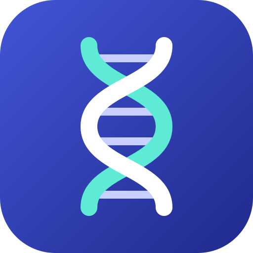

<p align="center"></p>

<h1 align="center">Génothèque</h1>

<p align="center">
  Les grandes bases publiques de génétique humaine, réunies dans une appli de téléphone gratuite.<br>
  <em>The major public human genetics databases, gathered in one free phone app.</em>
</p>

<p align="center">
  <a href="https://jimmydaviddarly-blip.github.io/genotheque/"><strong>Ouvrir l'appli · Open the app</strong></a>
  &nbsp;·&nbsp; <a href="#english">English</a>
</p>

<p align="center">
  Par <strong>Jimmy Darly</strong> · Studio Nébulis &nbsp;·&nbsp; Licence <a href="LICENSE">AGPL-3.0</a> &nbsp;·&nbsp; <a href="NOTICE.md">nom et logo réservés</a>
</p>

> **Information, pas diagnostic.** Génothèque affiche ce que disent les bases scientifiques publiques. Elle ne lit aucune donnée génétique personnelle, ne calcule aucun risque et ne remplace pas l'avis d'un médecin ou d'un conseiller en génétique. Ce n'est pas un dispositif médical.

---

## Ce que fait l'appli

Tapez un nom de gène (BRCA1, ERBB2, CFTR), un variant (rs429358) ou une maladie (mucoviscidose, maladie d'Alzheimer). Génothèque interroge en direct les bases qui font référence et rassemble leurs réponses sur une seule fiche, en français ou en anglais.

| Fiche | Ce qu'on y trouve | D'où ça vient |
|---|---|---|
| **Gène** | identité et position, protéine et fonction, structure 3D, activité dans 54 tissus, partenaires et voies biologiques, variants classés, maladies liées, médicaments qui le ciblent et leurs marques en France, effet du gène sur les médicaments | NCBI, Ensembl, HGNC, UniProt, AlphaFold, GTEx, STRING, Reactome, ClinVar, Open Targets, ClinGen, ChEMBL, BDPM, CPIC |
| **Variant** | fréquence dans neuf populations, interprétations et niveau de revue, scores prédictifs, associations avec des traits (p-valeur, article) | gnomAD v4, ClinVar, AlphaMissense, REVEL, CADD, GWAS Catalog |
| **Maladie** | résumé, nom français, symptômes par fréquence, gènes en cause évalués par des experts, médicaments, essais cliniques (dont en France) | Wikipédia, Wikidata, HPO, ClinGen, Open Targets, ClinicalTrials.gov |

Et aussi :

- **Explorer** : les familles de gènes (HGNC), les maladies rares par classification Orphanet, les cancers par zone du corps sur une silhouette.
- **Aide à la saisie** : dictionnaire de 30 698 noms de gènes officiels embarqué, complétion pendant la frappe et correction des fautes (« erbb » propose ERBB2).
- **Une explication simple** derrière chaque bouton « ? », pour lire une fiche sans être spécialiste.
- **Favoris** et **lien de partage** pour chaque fiche.
- **Clair ou sombre**, au choix ; **hors ligne** pour l'Explorer et le dictionnaire.
- **Sur ordinateur**, la recherche, les fiches récentes et les favoris restent à gauche, la fiche s'ouvre à droite sur deux colonnes : on passe d'un gène à l'autre sans perdre sa liste.

Chaque carte cite sa base et renvoie vers la page d'origine : les chercheurs retrouvent les identifiants standards (HGNC, Ensembl, UniProt, MONDO, ORPHA, rsID) et la source exacte de chaque information.

## Installer l'appli

Pas de magasin d'applications ni de fichier à télécharger : c'est une appli web installable (PWA). Deux clics, sans droits administrateur, mises à jour automatiques.

| Appareil | Comment faire |
|---|---|
| **Android** (Chrome) | ouvrir le lien, menu ⋮, « Installer l'application » (Chrome le propose souvent de lui-même) |
| **iPhone, iPad** (Safari) | ouvrir le lien, bouton Partager, « Sur l'écran d'accueil » |
| **Windows** (Edge ou Chrome) | ouvrir le lien, cliquer sur l'icône « Installer » à droite de la barre d'adresse |
| **Linux** (Chrome ou Chromium) | ouvrir le lien, icône « Installer » dans la barre d'adresse |
| **Mac** (Chrome, Edge ou Safari 17+) | icône « Installer » dans la barre d'adresse, ou dans Safari : Fichier, « Ajouter au Dock » |

Une fois installée, Génothèque s'ouvre dans sa propre fenêtre, avec son icône dans le menu Démarrer, le menu des applications ou l'écran d'accueil. Pour la retirer : clic droit (ou appui long) sur l'icône, « Désinstaller ».

Sans l'installer, elle fonctionne aussi directement dans n'importe quel navigateur récent, Firefox compris.

## Confidentialité

- Pas de compte, pas de publicité, pas de mesure d'audience, pas de cookie.
- Rien n'est envoyé à l'auteur de l'appli : il n'y a pas de serveur. Les recherches partent directement du téléphone vers les bases publiques listées ci-dessous, qui voient donc l'adresse internet du téléphone, comme pour toute page web.
- Les favoris et les réglages restent dans le téléphone.

## Ce que l'appli ne fait pas, volontairement

- Elle ne lit pas de résultat de test ADN (23andMe, MyHeritage, fichier VCF…).
- Elle ne calcule aucun risque personnel et ne donne aucun conseil médical.

Ce choix protège les utilisateurs : des données génétiques personnelles sont des données de santé, et un calcul de risque relèverait des dispositifs médicaux.

## Sources et licences des données

Les données restent la propriété de leurs producteurs. Génothèque les affiche en citant chaque source.

| Base | Producteur | Licence |
|---|---|---|
| NCBI Gene, dbSNP, ClinVar | National Center for Biotechnology Information (États-Unis) | Domaine public |
| MyGene.info, MyVariant.info | BioThings, Scripps Research | Agrégateurs ouverts, licences des sources d'origine |
| gnomAD v4 | Broad Institute | Ouvert, citation demandée |
| Projets de populations (1000 Genomes, HapMap, SGDP, TOPMed, ALSPAC…) | via dbSNP, NCBI | Domaine public, fréquences agrégées |
| GWAS Catalog | NHGRI et EMBL-EBI | Ouvert, citation demandée |
| UniProt | Consortium UniProt | CC BY 4.0 |
| Open Targets Platform | Open Targets | CC0 |
| ChEMBL (via Open Targets) | EMBL-EBI | CC BY-SA 3.0 |
| Wikidata | Wikimedia | CC0 |
| Wikipédia | Fondation Wikimedia | CC BY-SA 4.0 (résumés avec lien vers l'article) |
| AlphaFold | EMBL-EBI et Google DeepMind | CC BY 4.0 |
| Base de données publique des médicaments | ANSM, HAS, Assurance maladie | Réutilisation selon les conditions du site : source et date citées, données non altérées, ni approuvée ni cautionnée par ces organismes |
| CPIC | Clinical Pharmacogenetics Implementation Consortium | CC0 |
| Human Phenotype Ontology | Jackson Laboratory et Monarch Initiative | Libre, citation et version demandées |
| ClinGen | Clinical Genome Resource, NIH | CC0, attribution demandée |
| STRING | Consortium STRING | CC BY 4.0 |
| Reactome | Consortium Reactome | CC0 |
| Gene Ontology (via QuickGO) | Gene Ontology Consortium, EMBL-EBI | CC BY 4.0 |
| GTEx | Broad Institute, NIH Common Fund | Données ouvertes, citation demandée |
| ClinicalTrials.gov | National Library of Medicine (États-Unis) | Domaine public |
| AlphaMissense, REVEL, CADD (via dbNSFP) | Google DeepMind, Ioannidis et al., Université de Washington | dbNSFP CC BY-NC-ND 4.0, usage non commercial |
| Orphanet (Orphadata) | Inserm | CC BY 4.0 |
| HGNC | HUGO Gene Nomenclature Committee | CC0 |

Les classifications Orphanet, les familles HGNC, le dictionnaire des noms de gènes, les traductions françaises de la HPO, les évaluations ClinGen, la table CPIC et un extrait de la base des médicaments sont intégrés à l'appli (dossier `public/data`). Tout le reste est lu en direct.

## Pour les développeurs

JavaScript sans framework, construit avec [Vite](https://vite.dev/). Aucun serveur, aucune clé d'API.

```bash
npm install
npm run dev        # http://localhost:5180
npm run build      # appli construite dans dist/
npm run data       # régénère public/data depuis les bases (Orphanet, HGNC, HPO, ClinGen, CPIC, BDPM)
npm run i18n       # liste les textes sans traduction anglaise
npm test           # tests automatiques (recherche, cancers, populations, traductions, données, hygiène)
```

- `src/api.js` : tous les appels aux bases, avec délai maximal et validation des identifiants.
- `src/views.js`, `src/explore.js` : les pages ; toute donnée externe passe par `esc()` avant d'entrer dans la page.
- `src/i18n.js`, `src/i18n-en.js` : le texte français sert de clé, la traduction anglaise est à côté.
- `public/sw.js` : cache hors ligne de l'appli elle-même (jamais des réponses des bases).
- Politique de sécurité du contenu (CSP) injectée à la construction par `vite.config.js`.

Historique des versions : [CHANGELOG.md](CHANGELOG.md) et les [releases](https://github.com/jimmydaviddarly-blip/genotheque/releases), qui permettent de revenir à n'importe quelle version.

Une erreur, une base qui a changé, une traduction maladroite : ouvrez une [issue](https://github.com/jimmydaviddarly-blip/genotheque/issues) ou écrivez à studio.nebulis@gmail.com. Voir aussi [CONTRIBUTING.md](CONTRIBUTING.md) et, pour une faille de sécurité, [SECURITY.md](SECURITY.md).

## Créateur et contact

Génothèque est créée par **Jimmy Darly**, sous le nom d'atelier Studio Nébulis. Projet personnel, gratuit et non commercial.

- Contact et support : studio.nebulis@gmail.com
- Instagram : [@studio.nebulis](https://www.instagram.com/studio.nebulis/)
- Mentions légales, confidentialité et crédits complets : page **Infos › À propos** de l'appli.

## Licence

Le code est sous licence [GNU AGPL-3.0 ou ultérieure](LICENSE). En clair : vous pouvez l'utiliser, l'étudier et le modifier, y compris pour un usage commercial, mais toute version modifiée que vous proposez à d'autres, par un téléchargement ou par un site en ligne, doit rester ouverte sous la même licence, avec le nom de l'auteur et un lien vers ce dépôt. Le **nom « Génothèque », le logo et l'icône ne sont pas couverts** : une version modifiée doit prendre un autre nom. Détails : [NOTICE.md](NOTICE.md). Les données affichées et celles du dossier `public/data` restent sous la licence de chaque base : voir [DATA_LICENSES.md](DATA_LICENSES.md). Les licences des logiciels et polices livrés avec le site sont dans [public/THIRD_PARTY_NOTICES.txt](public/THIRD_PARTY_NOTICES.txt).

---

<a id="english"></a>

## English

**Genotheque** brings the major public human genetics databases together in one free phone app, in English or French.

> **Information, not diagnosis.** Genotheque shows what public scientific databases say. It reads no personal genetic data, computes no risk and does not replace advice from a doctor or genetic counsellor.

Type a gene (BRCA1, ERBB2), a variant (rs429358) or a disease (cystic fibrosis). Genotheque queries the reference databases live and gathers their answers on a single page:

- **Gene pages**: identity, protein and 3D structure, activity across 54 tissues, partners and pathways, ClinVar variants, linked diseases with expert reviews, drugs that target the gene, pharmacogenetics.
- **Variant pages**: frequency in nine populations (gnomAD v4), ClinVar interpretations with review status, AlphaMissense, REVEL and CADD scores, GWAS associations.
- **Disease pages**: summary, symptoms by frequency (HPO), causal genes (ClinGen, Open Targets), drugs and clinical trials.
- **Explore**: gene families, Orphanet rare disease classifications, cancers by body area.
- A built-in dictionary of 30,698 official gene names with completion and typo correction, plain-language help behind every "?" button, favourites, share links, light or dark theme. On a computer, search, recent pages and favourites stay on the left while the page opens on the right.

Every card names its source and links back to it.

**Install** (two clicks, nothing to download, automatic updates): open the link, then "Install app" from the ⋮ menu (Android, Chrome), Share › "Add to Home Screen" (iPhone, Safari), or the "Install" icon in the address bar (Windows, Linux and Mac with Edge or Chrome; Safari 17+: File › "Add to Dock"). It also runs in any modern browser without installing.

**Privacy**: no account, no ads, no analytics, no cookies, no server. Searches go straight from your phone to the public databases listed above. Favourites and settings stay on your phone.

**On purpose, it does not** read DNA test results or compute any personal risk.

Data belongs to its producers and is shown with attribution (see the table above). Some scores (AlphaMissense, REVEL, CADD via dbNSFP) are for non-commercial use only.

Made by **Jimmy Darly** (Studio Nébulis), a personal, free, non-commercial project. Contact and support: studio.nebulis@gmail.com. Legal notice, privacy and full credits: **Info › About** in the app.

Version history: [CHANGELOG.md](CHANGELOG.md) and the [releases](https://github.com/jimmydaviddarly-blip/genotheque/releases).

Developers: see the commands above. Bug reports and suggestions are welcome as [issues](https://github.com/jimmydaviddarly-blip/genotheque/issues) or by email; see [CONTRIBUTING.md](CONTRIBUTING.md) and [SECURITY.md](SECURITY.md).

The code is released under the [GNU AGPL-3.0 or later](LICENSE): you may use, study and modify it, including commercially, but any modified version you offer to others, by download or as an online service, must stay open under the same licence, with the author's name and a link to this repository. The **name "Genotheque", the logo and the icon are not covered**: a modified version must use another name. Details: [NOTICE.md](NOTICE.md). Data stays under each database's own licence: see [DATA_LICENSES.md](DATA_LICENSES.md).
